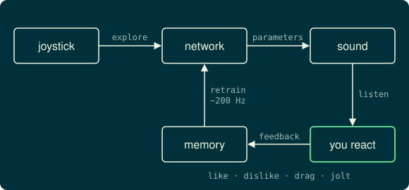

# Introduction

NISPS (Neural Interactive Shaping of Parameter Spaces) lets you shape the sound of a synth, effect or external instrument by feel, without editing its parameters directly. A small neural network maps a few inputs, usually the joystick, to every parameter of the sound engine. You move the joystick to explore. When you hear something you like or dislike, you say so with a switch, and the network retrains while you play. Over time, the sounds you like settle where you put them, and the sounds you dislike change.

All of the NISPS firmwares share the same controls and screens. This page describes them. Each firmware's own page lists what it adds or changes.

{:class="img-responsive"}

# Quick start

1. Flash a NISPS firmware (see the [firmware guide](/memlnaut/firmwares/guide)), plug in headphones or line out, and turn up **G**.
2. Move the joystick. Each position gives a different sound.
3. When you find a sound you like, push **momentary B up**. Do this in three or four different joystick positions.
4. If you hear something you don't like, push **momentary B down**.
5. Hold **toggle B up** (or press the joystick down) to freeze the current sound. Move the joystick somewhere else, then release. The sound is stored at the new position.
6. If you want a completely new set of sounds, push **momentary A up** to scramble the network. To keep what you have but add some variety in the places you haven't taught yet, push **momentary A down** (jolt).
7. Save your model to the SD card from the **Save Model** screen.

# Controls

<a href="{{ '/assets/images/nisps/memlnaut-panel-nisps.svg' | relative_url }}" class="image-popup" title="MEMLNaut panel with NISPS controls"></a>

*Click the panel to enlarge it.*

## Switches

The momentary switches spring back to the middle. The toggles stay where you put them.

| Switch | Up | Down |
|---|---|---|
| **Momentary A** (left) | **Scramble**: new random network, a whole new set of sounds | **Jolt**: add new sounds in parts of the joystick range you haven't taught yet, keeping the sounds you like |
| **Momentary B** (right) | **Like**: store the current joystick position and sound as a pair you like | **Dislike**: change this sound. Pressing it again in the same place tries harder ([see below](#what-a-dislike-does)) |
| **Toggle A** (left) | Not used | **Forget**: empty the memory of likes |
| **Toggle B** (right) | **Drag**: freeze the sound while you move the joystick; switching back stores it at the new position | Mode-specific (for example sequencer start/stop) |

Pressing the joystick down also works as **Drag**.

## Knobs

| Knob | Default use |
|---|---|
| **X** | Learning rate: how quickly the network moves towards what you've told it. At zero it stops learning |
| **Y** | Reward scale: how strongly a like counts. Some modes use this knob for something else, such as tempo |
| **Z** | Exploration: how far the whole mapping wanders on its own. It wanders less close to your likes. At zero the mapping holds still |
| **G** | Output volume |

## Encoder and touchscreen

Turn the **encoder** to step through the screens. On a selection screen (for example Input Source), press the encoder to take control of the screen. A yellow line shows that the screen has control. Turn to choose, then press again to confirm. Screens with buttons, such as Save Model and Focus, are used by touching the screen.

# Screens

The screens appear in this order. Firmwares add their own screens after the RL screen.

| Screen | What it shows or does |
|---|---|
| **RL** | Every network output as a bar, plus the training loss, the number of likes in memory and the last gesture |
| *Mode screens* | For example **Focus**, **Enable** and **Mixer** (see each firmware's page) |
| **NN Inputs** | The inputs going into the network. With a joystick, this includes an X/Y map |
| **Messages** | Recent messages, such as "Where do you want it?" while dragging. Not every firmware has this screen |
| **Save Model** | 12 slots on the SD card. Touch a slot, then type a name |
| **Load Model** | Touch a slot to load it. The slot in use is highlighted |
| **Input Source** | Chooses what drives the network (see below) |
| **Help** | What the controls do |
| **System Info** | Information about the MEMLNaut and the current firmware |

## What a dislike does

A dislike asks NISPS to change the sound at the current joystick position. If you keep pressing in the same place, the response escalates:

1. The sound is nudged away from the liked sounds nearby
2. The sound goes back to the nearest liked sound
3. NISPS tries something new, either close to a sound you've liked or somewhere else entirely

A like starts this sequence again. If you dislike a sound that you liked at the same position, the like is removed from memory. A dislike close to a jolted sound tries a different sound there instead, and a dislike while exploration is turned up also moves the exploration somewhere else.

## Input sources

| Source | Inputs |
|---|---|
| **3D joystick** | Joystick X, Y and twist |
| **4D joystick** | X, Y, Z and W |
| **MIDI CC1** | Mod wheel |
| **MIDI CC1-3** / **CC1-8** | MIDI controllers 1 to 3, or 1 to 8 |
| **Machine listening** | Features of the audio input: pitch, energy, brightness and others (only in firmwares that analyse audio) |
| **Combined** | Joystick plus audio features |

The choice is remembered when you turn the MEMLNaut off.

# Focus

Firmwares with many parameters group them, for example by voice or by sequencer and synth. On the **Focus** screen you choose which groups are live. The other groups hold their current values, and likes and dislikes only reshape the groups in focus. With nothing selected, everything is live.

Focus works as a local edit at the current position:

- Liked sounds nearby stop holding the focused parameters, so your edit isn't pulled back to the old values. They still hold all the other parameters. A new like replaces the old one.
- A jolt also changes the sound at and around the current position.
- A dislike won't remove a like.
- Exploration isn't reduced near likes.

# Saving and loading

Models are saved to the SD card, with 12 slots per firmware. A saved model includes the network, the memory of likes, and any settings the firmware stores with it. A model can only be loaded into the firmware that saved it.

# How it learns

The network has two hidden layers of 16 units. Likes and drags are stored in a memory of 64 experiences. About 200 times a second, the network trains a little on that memory, so each liked sound settles at its joystick position. A dislike gives the network a short-lived target that moves the sound at that position. A jolt adds its own training points away from your likes, which stay until the next jolt. Some firmwares, such as [MixMasterMEML](/memlnaut/firmwares/mixmastermeml), stop training once the network has learned your likes, and start again when you give new feedback.

# Context

NISPS is a method for interactive engagement with the training process of machine learning models, based in reinforcement learning (RL) principles.  NISP merges exploration and optimisation into a continuous experience.  It builds on our [first experiments with RL](./carl), and also brings in exploration features from the [POPR](./popr) approach that give further option for shaping of sound.   The approach is called NISPS because it allows you to creatively refine how the joystick on MEMLNaut controls sound, in a dialog between the musician and the instrument.

The MEMLNaut system takes an input (usually from the 3D joystick), passes this input into a machine learning (ML) system, and then the ML system outputs a set of parameters which control sound processing. This might be the sounds of a synthesiser, or the way in which a set of effects are applied to audio input.  Algorithms on the MEMLNaut allow the musician to tune the ML system; to guide it towards making different sounds in reaction to different inputs.  This allows large and complex sound processes to be controlled in musically meaningful ways from low dimensional inputs, a bit like controlling all the knobs at once of a large synthesiser just by moving a joystick.  This approach to sound control allows musicians to set up expressive and dynamic mappings. However, it can be a challenge to find the right mappings in a *musical* way, which is where the MEML project's experimentation with machine learning approaches offers new solutions.

# Machine Learning Background

NISPS draws on the core idea of reinforcement learning, that an algorithm is rewarded for doing something well, and penalised for doing something that is undesired.  Conventionally, RL systems are comprised of an *agent* and an *environment*; the agent explores the environment and is rewarded (or not) for it's actions. The agent tries to estimate the value of current and future actions based on how it has been rewarded. Through ongoing exploration, the agent is optimised towards achieving a particular task, for example playing a game or controlling a robot.  In the context of the MEMLNaut, we have a different scenario from this traditional RL configuration;  there is no concept of *future* on which to estimate the value of rewards (we call this a *stateless* system), the ML system maps whatever the musician's current input is into sound parameters, which no regard for what might happen next. Secondly, the concept of a penalty is ambiguous. In a typical RL system, the agent receives a penalty because if made an error or exhibited undesirable behaviour.  In a creative musical system, there's no explicit wrong action, but instead there are actions that the musician has an aesthetic preference for or against (e.g. i don't like the sound that happens when the joystick is in this position). Bearing these differences in mind, NISPS draws on the core concepts of RL, and adapts them to work within an interactive, stateless environment. NISPS aims to provide the musicians with controls over the machine learning process so that it can become a creative component of musical practice.


# Elements of NISPS

## Control Inputs

These are what the musician uses to play the system and influence how sound is generated or processed.  It might be a combination of the following:

1. The MEMLNaut joystick
2. MIDI Inputs
3. Machine listening obserations of audio input

## Sound System

This might be a synthesiser, an effects processor, or a combination of the two. The sound system will have a set of parameters available that determine its behaviour, the equivelant of the knobs and sliders on a synthesiser.

## Voice Spaces

A voice space is a hand-designed translation layer that sits between the outputs of the neural network and the controls of the sound system.  It biases the controls in certain ways, for example it might make a synthesis more likely to produce bass sounds, or it might make an effects unit more likely to produce distorted sounds.  It constrains the neural network to exploring certain areas of what the sound system is capable of making.

## The Neural Network

The neural network takes input, and transforms this into parameters for controlling sound.  The net is malleable, and can continually change in use.  Everytime the input changes, the sound control parameters will change.  If the system is not being optimised, the neural network will behave consistently, i.e. the same input will always produce the same output.  If the system is being optimised, then the relationship between input and output can be adjusted.

## Rewards

Rewards tell NISPS when the musician has a preference (positive or negative) for how the neural network behaves. i.e. how it takes input and translates it into parameters for sound control.  A positive reward tells NISPS that you like the sound that is being made for a particular input. A negative reward signifies the opposite.

## Replay Memory

This is a collection of the most recent positive rewards, along with a snapshot of the inputs and neural network outputs at the moment the reward was given.  The replay memory is finite, and when it is full, older memories are forgotten.  It's saved along with each model, so when you load a model, NISPS carries on with the rewards that model was trained on.

## Optimisation

This is a process that continually runs in the background.  As soon as NISPS has enough memories to work with, it begins to adjust the neural network to match the musicians preferences.

## Controls for NISPS

These govern how the neural network changes during optimisation.

### Positive and negative rewards

A positive reward places an item into the replay memory.

A negative reward asks NISPS to change the sound at the current input. If you keep pressing in the same place, the response escalates:

1. The sound is nudged away from the positively rewarded sounds nearby
2. The sound goes back to the nearest positively rewarded sound
3. NISPS tries something new, either close to a sound you've rewarded or somewhere else entirely

A positive reward starts this sequence again. If you give a negative reward to a sound that you rewarded positively at the same input, the positive reward is removed from the replay memory.

### Scramble the neural network

This randomises the neural network, which in effect gives a completely new mapping from input to sound control.  If there are items in replay memory, then the optimisation system will adjust the randomised network towards the musicians preferences following randomisation.

### Jolt the neural network

This puts new sounds into the parts of the input space that you haven't rewarded, while the sounds you have rewarded stay in place.  It's useful if the optimisation process is stuck, or if you just want to find something new.  A jolt moves the mapping as a whole, so it keeps its overall shape.  If you like a new sound, give it a positive reward to keep it.  If you don't, a negative reward will try a different sound in that place.

### Reward scaling

You can change the scaling of positive rewards, i.e. how much you like a certain mapping.  You can tell the system, for example, that you *really like* something, or that you have a *slight preference* for something else.  Some firmwares use this knob for a different purpose; see the page for each firmware.

### Learning Rate

This is a speed at which the system is optimised according to your rewards.  If you're happy with how the system is behaving, then you can turn this all the way down to ```0``` and the system will not change. A high learning rate might mean that the system has less precision about how it learns, but will learn quickly.  With a medium learning rate, there might be more precision but the system will adjust more slowly. Learning rates which are too fast or two slow might mean the system can either *overshoot* the optimal solution or *undershoot* and get stuck in a suboptimal solution.  In NISPS and creative machine learning, the concept of an optimal solution is often ambiguous or unknown. Optimisation of neural networks is not an exact science, which is why NISPS offers these interactive controls to the musician who can develop an intuitive feel for steering this process. 

### Exploration Noise

The exploration noise control adds increasing amounts of slow moving noise to the weights of the neural network, so that the whole mapping morphs smoothly.  This is a method, taken from reinforcement learning, that allows exploration of the sound space.  The noise only affects what you hear, not the training, and it's reduced close to inputs you've rewarded, so you can explore the gaps and keep the sounds you like.  A negative reward while the noise is on also moves the noise somewhere else.  E.g. if you want to find a different sound for a particular place on the joystick, then turn up the exploration noise and wait until you like the sound, then reward the system for that sound and turn the noise off. You'll find that the system now adjusts towards that sound.  *Note:* check that you don't leave this control on when not needed, as it will mask the true behaviour of the neural network.

### Positive Reward Placement

This is where you can not just reward the combination of input and sound, but move that rewarded input to somewhere else in the space of possible inputs. For example, using the joystick, you might take the input-sound combination for the joystick in the up position, but place the reward instead in the down position. NISPS will then adjust the neural network so that sound tends to appear in the down position.   This is a way of organised and editing the mappings of the neural network.  You can be creative with this system.  For example, you might place several input-sound combinations in the same position, and then the neural network will tend towards a sound that's somewhere in between these sounds.

### Forgetting

You might need a fresh start, in which case you can clear the replay memory of all the rewards you have collected, and collect new ones. If you forget the memory and then ramdomise the network, you are starting from a completely new place.

# Firmwares

- [MEMLCelium](/memlnaut/firmwares/memlcelium): three-voice formant synth with a ratio sequencer
- [MixMasterMEML](/memlnaut/firmwares/mixmastermeml): three drum voices, bass, arpeggiator, grain delay and a mixer
- [VerbFX](/memlnaut/firmwares/verbfxnisps): reverb, filterbank and delays for the line input
- [LiveFX](/memlnaut/firmwares/livefxnisps): ten tempo-synced effects for live performance and DJing
- [Infinibits](/memlnaut/firmwares/infinibitsnisps): granular drone synth
- [Paramsite](/memlnaut/firmwares/paramsitenisps): MIDI controller for any synth, drum machine, effect or DAW
- [PAF Synth](/memlnaut/firmwares/pafsynthnisps): Phase Aligned Formant synth, played over MIDI

# Code

[https://github.com/MusicallyEmbodiedML/MEMLNaut-NISPS](https://github.com/MusicallyEmbodiedML/MEMLNaut-NISPS)
