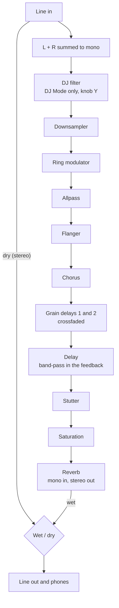

# Overview

The LiveFX firmware is a creative, interactive effects processor, using the [NISPS](../approaches/nisps) approach to ML.

# LiveFX

LiveFX is an interactive FX unit with 10 different effects.  It can be used in 'DJ Mode' as a DJ effect processor controlled by the 3D joystick, mixing in effects when the joystick moves away from the centre position.  It can also be used as a traditional FX unit with a manually set wet/dry balance.

## Signal Flow

*The wet/dry mix follows the joystick's distance from centre in DJ Mode, or knob Y with DJ Mode off. The effects run in mono until the reverb, which makes them stereo.*

## Effect Blocks

LiveFX chains ten effect blocks, plus a DJ-style input filter. Each block can be switched
on or off independently from the [FX Enable](#fx-enable) screen, and its parameters are
driven by the neural network as you explore with the joystick.

The time-based blocks (both grain delays, the delay, and the stutter gate) are **tempo
synced** — their times snap to musical subdivisions of the current BPM rather than to free
values, so rhythmic effects lock to the beat.

Most blocks have their own internal **wet/dry "mix"** parameter with a built-in dead zone:
the effect stays silent until its control passes roughly 30%, then fades in up to fully wet.
This means a neural-network output sitting near its centre leaves the effect inactive, and
only deliberate movement brings it in — keeping the sound clean until you reach for it.

### DJ Filter

A single-knob DJ-style sweep filter applied to the input before any other processing. Turn
the knob left of centre for a **low-pass** sweep (gently rolling off from 20 kHz down to a
muffled 40 Hz) and right of centre for a **high-pass** sweep (thinning out from 20 Hz up to
20 kHz). At centre the filter is transparent. (Active only in DJ Mode; with DJ Mode off this
knob becomes the manual wet/dry control instead.)

### Downsampler

A sample-rate reducer for lo-fi, "crushed" digital textures. Reducing the effective rate by
a factor of 1–32 introduces aliasing and grit, from a subtle digital edge to harsh,
ring-modulator-like artefacts at the extreme.

### Ring Modulator

Multiplies the signal by an internal sine oscillator whose frequency sweeps from 1 Hz up to
2 kHz. Low frequencies give slow tremolo; higher frequencies produce the classic clangorous,
metallic, inharmonic ring-mod timbre.

### Allpass

An allpass filter with a modulating delay line — a resonant, phasey colouration that smears
transients without changing the overall tone balance. The delay length (≈100–2000 samples)
sets the character, an internal LFO (0.1–10 Hz, with adjustable depth) animates it, and a
feedback coefficient (0.3–0.8) controls how pronounced and resonant the effect becomes.

### Flanger

A short modulated delay (≈5–240 samples) swept by an LFO at 0.1–5 Hz to create a
sweeping comb-filter effect. With feedback (up to ~0.9) the swept notches become
sharp and resonant for a more intense, metallic flange.

### Chorus

A longer modulated delay (≈240–1440 samples) at 0.1–3 Hz that thickens and widens the sound
by detuning a delayed copy against the original. Gentler than the flanger, with milder
feedback, for warmth and shimmer rather than dramatic sweeps.

### Grain Delay 1

A granular delay that chops the input into overlapping grains and replays them. Grain 1 uses
**longer grains (30–250 ms)** for smeared, textural, ambient clouds. Each grain can be
**pitch-shifted** up or down by an octave, with an adjustable amount of random **pitch
spread** across grains for shimmering, detuned tails. The grain trigger time snaps to a beat
subdivision (1/16 up to a dotted 1/2 note), feedback recirculates the grains for building
textures, and a **freeze** switch latches the current buffer into an infinite, evolving pad.

### Grain Delay 2

A second, independent grain delay tuned for **shorter grains (10–100 ms)** — tighter,
glitchier, more rhythmic stutters and buzzes — with its own pitch shift, a wider pitch-spread
range, beat-synced trigger time, feedback, and freeze. Grains 1 and 2 run in parallel and are
blended by a crossfade control, then mixed back with the dry signal, so you can morph between
long ambient washes and short glitchy textures.

### Delay

A tempo-synced feedback delay. The delay time snaps to a beat subdivision (1/16 up to a
dotted 1/2 note, up to ~340 ms) and feedback (up to ~0.95) sets how many repeats build up.
Its feedback path runs through a **resonant band-pass filter** (40 Hz–16 kHz, Q up to 10)
that progressively colours each repeat — useful for dub-style filtered echoes that darken,
brighten, or resonate as they decay.

### Stutter

A beat-synced gate that rhythmically chops the signal on and off. The gate rate locks to a
musical subdivision (1, 2, 4, 8, or 16 steps per beat) and the **duty cycle** (5%–95%) sets
how long the gate stays open each step — from short rhythmic clicks to long held pulses, for
gated/trance-gate and glitch effects.

### Reverb

A modulated stereo reverb on the wet bus, and the only block that produces a true stereo
image. It offers a full set of controls: **size** and **decay** for the space and tail
length, **damping** and **low cut** for tonal shaping, **diffusion** for density,
**modulation** (depth and rate) for a chorused, shimmering tail, **pre-delay** to separate
the reverb from the dry sound, **stereo width**, and **saturation** for a warmer, driven
character.

## Audio Inputs

The processor takes a stereo input. 

## Outputs

The dry signal is output in stereo.  The effects signal is added in mono.

# Quick start

1. Flash the firmware, connect a sound source to the line input and turn up **G**.
2. On the **RL** screen, tap the tempo button four times in time with the music.
3. Push the joystick away from the centre. In DJ Mode, the further you push, the more of the effects you hear. At rest the sound is dry.
4. Like, dislike, drag and jolt as described on the [NISPS page](/memlnaut/approaches/nisps#quick-start).

# NISPS

When you indicate a reward, you are rewarding (negatively or positively) how a particular joystick position is mapped to the effect sound it's producing. As you indicate preferences for these settings, the NISPS system will start to tune the mappings towards your preference. See the [NISPS](../approaches/nisps) documentation for further info.

# Controls

*Click the panel to enlarge it. Controls ringed in gold work differently from the standard NISPS controls.*

The controls are the standard [NISPS controls](/memlnaut/approaches/nisps#controls), with these changes.

## DJ Mode (on by default)

| Control | In DJ Mode |
|---|---|
| **Joystick X and Y** | Explore, and also set the wet/dry mix: dry at the centre, fully wet near the edge |
| **Knob Y** | DJ filter: low-pass when turned left of centre, high-pass when turned right, no filter at the centre |

## DJ Mode off

| Control | With DJ Mode off |
|---|---|
| **Joystick** | Explore only |
| **Knob Y** | Wet/dry mix. The DJ filter is bypassed |

Turn DJ Mode on or off on the [Options](#options) screen.

# Screens

Navigate between screens using the rotary encoder.

## RL 

Info on the neural network - the outputs, the current error rate, the number of datapoints in replay memory, and the most recent command.  The green button is a tap-tempo for synchronising delay lines.

## Focus

Selecting one or more items in the focus menu freezes all *unfocused* neural network outputs at their current value, so that NISPS only changed the *focused* values.  This let's you do detailed training, e.g. if you just want to adjust the reverb but not other sounds.

## FX Enable

Toggle each of the ten effect blocks on or off: Allpass, Flanger, Chorus, Grain 1, Grain 2, Delay, Downsamp, Stutter, Ring Mod, Reverb.

## VU

Four VU meters showing input and output levels — In L, In R, Out L, Out R — useful for
setting input levels and confirming the signal is reaching both channels.

## NN Inputs

Shows the inputs to the neural network.

## Messages

Various messages logging interactions with the system.

## Save Model

Tap on a slot to save a model and current voice space,

## Load Model

Tap on a slot to load a model.

## Input Source

Choose from 
- the joystick that matches your hardware (3D or 4D) 
- machine listening analysis of the line input (allows the system to adapt to different sounds)
- various configurations of MIDI controllers

## Options

A single toggle for **DJ Mode**:

- **On** (default): the joystick position drives the wet/dry mix (dry at centre, fading to
  fully wet as you move away), and the DJ Filter knob sweeps the input filter.
- **Off**: the wet/dry mix is set manually with the knob, and the input filter is bypassed —
  use this for a traditional FX unit with a fixed wet/dry balance.

## Help

Shows what the various controls do.

## System Info

System information about the MEMLNaut and current firmware.

# Parameters

| Outputs | What they control |
|---|---|
| 0–7 | Grain delay 1: grain length, start time (in beat divisions), feedback, pitch, pitch spread, freeze and more |
| 8–15 | Grain delay 2 |
| 16–17 | Crossfade and mix between the grain delays |
| 18–20 | Delay |
| 21–25 | Flanger |
| 26–30 | Chorus |
| 31–35 | Allpass and its LFO |
| 36–37 | Downsampler |
| 38–40 | Stutter gate |
| 41–42 | Ring modulator |
| 43–45 | Band-pass filter in the delay feedback: frequency, Q and mix |
| 46–56 | Reverb |

# MIDI

This firmware doesn't send the neural network outputs as MIDI. It does listen for MIDI CCs, so you can control NISPS from a footcontroller or similar:

| CC | Action |
|---|---|
| 1 | Positive reward |
| 2 | Negative reward |
| 3 | Scramble neural network |
| 4 | Clear replay memory |
| 5 | Exploration noise |
| 6 | Training speed |

If you choose a MIDI controller on the [Input Source](#input-source) screen, CCs 1-8 become inputs to the neural network instead.

# Files

## Code

[https://github.com/MusicallyEmbodiedML/MEMLNaut-NISPS](https://github.com/MusicallyEmbodiedML/MEMLNaut-NISPS). To build this firmware, define `MODE_DJFX` in `MEMLNaut-NISPS.ino` (LiveFX was previously called DJFX).

## Firmware Download

[MEMLNaut-NISPS.LiveFX.1.2.0.uf2](https://github.com/MusicallyEmbodiedML/MEMLNaut-NISPS/releases/download/1.2.0/MEMLNaut-NISPS.LiveFX.1.2.0.uf2)

See the firmware [guide](./guide) for installation instructions.
