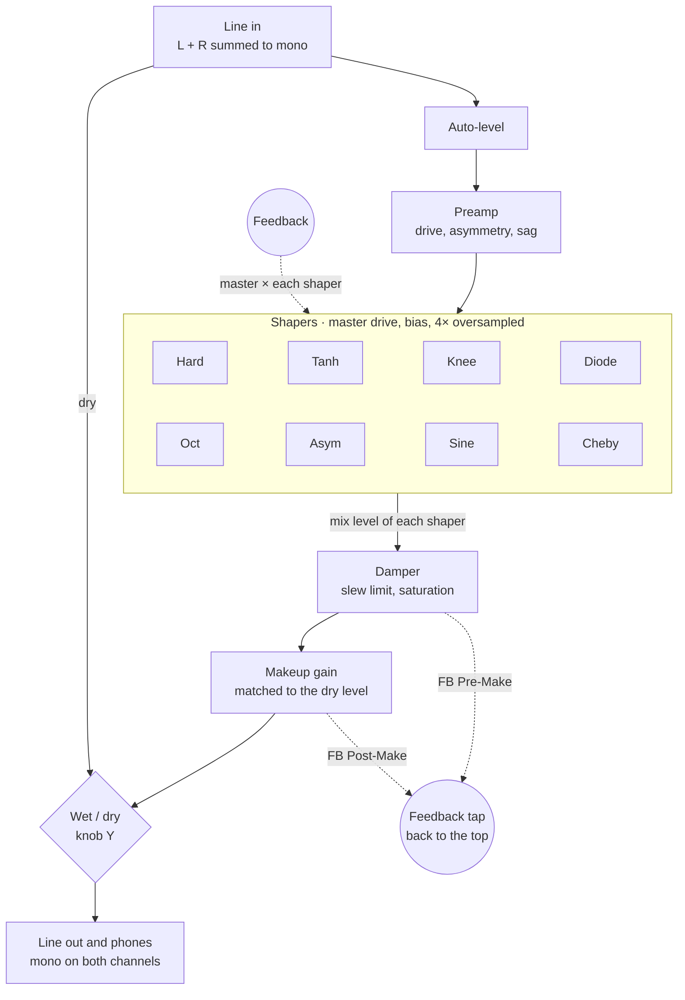

# Overview

NautLinear is a nonlinear tone and harmonics processor. It shapes sound with a range of waveshaping processors, creating tonal changes and adding warmth and complexity ranging from subtle to extreme. A preamp drives eight waveshapers side by side, a damper tames the result, and feedback sends the output back into the shapers. The neural network controls 47 parameters, and you shape them with the [NISPS](/memlnaut/approaches/nisps) controls.

## Signal path

*Dotted lines are feedback: the tap at the bottom feeds the **Feedback** node at the top. The **Options** screen chooses where the tap is taken from.*

## The preamp

The input is levelled, then driven into a soft saturator with an adjustable bias. The bias makes the curve asymmetric, which adds even harmonics. With **sag**, the bias also shifts with the input level, the way a driven valve stage does: loud attacks get more even harmonics, and the tone relaxes as the note decays.

## The shapers

| Shaper | Sound |
|---|---|
| **Hard** | Hard clipping: flat-topped, buzzy |
| **Tanh** | Smooth saturation |
| **Knee** | Clipping that goes from soft to hard |
| **Diode** | Diode-style clipping, softer on one side than the other |
| **Oct** | Octave-up fuzz: a rectifier that goes from half-wave to full-wave |
| **Asym** | Bends the positive and negative halves of the wave differently |
| **Sine** | Wavefolding |
| **Cheby** | A harmonic mixer that adds the 2nd to 7th harmonics |

The first five share a master drive, each with its own trim. Hard, Tanh and Knee also share a bias, which adds even harmonics. Sine and Cheby have their own input levels instead. Each shaper has its own mix level and its own feedback amount.

## The damper

At the end of the shaped signal, and so inside the feedback loop:

- a **slew-rate limiter**, which only acts on fast, loud movements, so it tames screaming high-frequency feedback without dulling quiet playing;
- a **soft saturator**, which bounds the level going round the loop.

## Level

NautLinear matches the loudness of the shaped sound to the dry input, so changing the parameters changes the tone more than the volume. A soft limiter keeps the output from clipping.

## Inputs and outputs

The processor takes a stereo line input. Left and right are summed to mono before processing. Mono processed sound is output to both channels of the line out and headphone sockets. Set the input level on the **Levels** screen.

# Quick start

1. Flash the firmware, connect a sound source to the line input and turn up **G**.
2. Set the input level on the **Levels** screen.
3. Set the wet/dry balance with **knob Y**.
4. Move the joystick, then like, dislike, drag and jolt as described on the [NISPS page](/memlnaut/approaches/nisps#quick-start).
5. Turn shapers, feedback, the preamp and the damper on or off on the **Enable** screen.

# Controls

*Click the panel to enlarge it. Controls ringed in gold work differently from the standard NISPS controls.*

The controls are the standard [NISPS controls](/memlnaut/approaches/nisps#controls), with this change:

| Control | In NautLinear |
|---|---|
| **Knob Y** | Wet/dry mix (instead of reward scale) |

The network's input defaults to the joystick. You can change it on the **Input Source** screen, including to machine listening of the line input.

# Screens

NautLinear adds three screens after the Neural Net screen. The **Levels** screen, with the input gain, comes at the end as in every firmware (see the [NISPS page](/memlnaut/approaches/nisps#screens)).

**Neural Net**: the 47 outputs are labelled by section: **Pre**, **Shape**, **Mix**, **Damp** and **FB**.

**Focus**: choose which parts the network changes. The parts are **Hard**, **Tanh**, **Knee**, **Diode**, **Oct**, **Asym**, **Sine**, **Cheby**, **FB**, **Pre** and **Damp**. Each shaper's group includes its mix level and feedback amount. **Pre** covers the input levelling and the preamp. The focus is not saved.

**Enable**: turn each shaper, the feedback (**FB**), the preamp (**Pre**) and the damper (**Damp**) on or off. Highlighted parts are on. Turning a shaper off takes it out of the blend, and the others rebalance to fill the level.

**Options**: choose where the feedback is taken from.

- **FB Pre-Make** (the default) takes the feedback before the level matching. The feedback can keep sounding, and even howl, after the input stops.
- **FB Post-Make** takes it after the level matching. The feedback mostly changes the tone, and dies away with the input.

## Saving

The **Enable** and **Options** settings are saved with each model, and come back when you load it.

# Parameters

| Outputs | Section | What they control |
|---|---|---|
| 0–6 | Pre | Input levelling, preamp drive, asymmetry, sag amount and sag recovery, master drive, bias |
| 7–27 | Shape | Drive trims for Hard, Tanh, Knee, Diode and Oct; knee hardness; diode softness; octave rectifier; Asym curves; Sine input level, fold depth and asymmetry; Cheby input level and the 2nd to 7th harmonics |
| 28–35 | Mix | Level of each shaper |
| 36–37 | Damp | Slew limit and saturation |
| 38–46 | FB | Master feedback, and feedback into each shaper |

# MIDI

This firmware doesn't send the neural network outputs as MIDI. It does listen for MIDI CCs, so you can control NISPS from a footcontroller or similar:

| CC | Action |
|---|---|
| 1 | Positive reward |
| 2 | Negative reward |
| 3 | Scramble neural network |
| 4 | Clear replay memory |
| 5 | Exploration noise |
| 6 | Training speed |

If you choose a MIDI controller on the **Input Source** screen, CCs 1-8 become inputs to the neural network instead.

# Files

## Code

[https://github.com/MusicallyEmbodiedML/MEMLNaut-NISPS](https://github.com/MusicallyEmbodiedML/MEMLNaut-NISPS). To build this firmware, define `MODE_NAUTLINEAR` in `MEMLNaut-NISPS.ino`.

## Firmware Download

[MEMLNaut-NISPS.NautLinear.1.2.1.uf2](https://github.com/MusicallyEmbodiedML/MEMLNaut-NISPS/releases/download/1.2.1/MEMLNaut-NISPS.NautLinear.1.2.1.uf2)

See the firmware [guide](./guide) for installation instructions.
