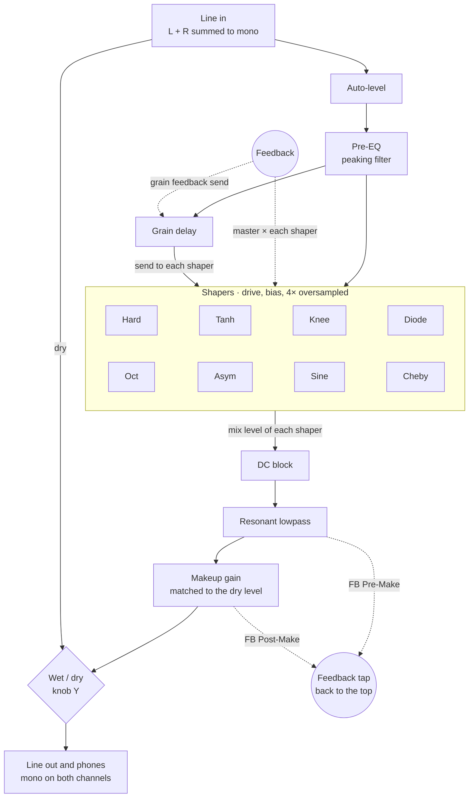

# Overview

NautLinear is a distortion and waveshaping effect for the line input. Eight waveshapers run side by side, with filters before and after them, a grain delay that feeds them, and feedback from the output back into their inputs. The neural network controls 60 parameters, and you shape them with the [NISPS](/memlnaut/approaches/nisps) controls.

## Signal path

The input is levelled and passes through a peaking EQ. A grain delay picks up the same signal. The EQ'd input, the grain delay and the feedback are mixed into each of the eight shapers, each in its own amounts. The shapers' outputs are blended, filtered by a resonant lowpass and brought back to the level of the dry input. Knob Y mixes the result with the dry signal.

A copy of the shaped signal is fed back into the shapers and into the grain delay.

*Dotted lines are feedback: the tap at the bottom feeds the **Feedback** node at the top. The **Options** screen chooses where the tap is taken from.*

## The shapers

| Shaper | Sound |
|---|---|
| **Hard** | Hard clipping: flat-topped, buzzy |
| **Tanh** | Smooth saturation |
| **Knee** | Clipping that goes from soft to hard |
| **Diode** | Diode-style clipping, softer on one side than the other |
| **Oct** | Octave-up fuzz: a rectifier that goes from half-wave to full-wave |
| **Asym** | Bends the positive and negative halves of the wave differently |
| **Sine** | Wavefolding |
| **Cheby** | A harmonic mixer that adds the 2nd to 7th harmonics |

The first five share a master drive, each with its own trim. Hard, Tanh and Knee also share a bias, which adds even harmonics. Sine and Cheby have their own input levels instead.

## Level

NautLinear matches the loudness of the shaped sound to the dry input, so changing the parameters changes the tone more than the volume. The input can also be levelled automatically, which gives the shapers a steady signal to work on.

## Inputs and outputs

The processor takes a stereo input. Left and right are summed to mono before processing. Mono processed sound is output to both channels of the line out and headphone sockets.

# Quick start

1. Flash the firmware, connect a sound source to the line input and turn up **G**.
2. Set the wet/dry balance with **knob Y**.
3. Move the joystick, then like, dislike, drag and jolt as described on the [NISPS page](/memlnaut/approaches/nisps#quick-start).
4. Turn shapers, feedback and the delay on or off on the **Enable** screen.

# Controls

*Click the panel to enlarge it. Controls ringed in gold work differently from the standard NISPS controls.*

The controls are the standard [NISPS controls](/memlnaut/approaches/nisps#controls), with this change:

| Control | In NautLinear |
|---|---|
| **Knob Y** | Wet/dry mix (instead of reward scale) |

The network's input defaults to the joystick. You can change it on the **Input Source** screen, including to machine listening of the line input.

# Screens

NautLinear adds four screens after the RL screen.

**RL**: the 60 outputs are labelled by section: **Pre**, **Shape**, **Mix**, **Post**, **FB** and **Grain**.

**Focus**: choose which parts the network changes. The parts are **Hard**, **Tanh**, **Knee**, **Diode**, **Oct**, **Asym**, **Sine**, **Cheby**, **FB** and **Delay**. Each shaper's group includes its mix level, feedback and grain send. The input EQ, levelling and the lowpass filter aren't in any group, so they hold still while anything is focused. The focus is not saved.

**Enable**: turn each shaper, the feedback (**FB**) and the grain delay (**Delay**) on or off. Highlighted parts are on. Turning a shaper off takes it out of the blend, and the others rebalance to fill the level.

**VU**: input and output levels.

**Options**: choose where the feedback is taken from.

- **FB Pre-Make** (the default) takes the feedback before the level matching. The feedback can keep sounding, and even howl, after the input stops.
- **FB Post-Make** takes it after the level matching. The feedback mostly changes the tone, and dies away with the input.

## Saving

The **Enable** and **Options** settings are saved with each model, and come back when you load it.

# Parameters

| Outputs | Section | What they control |
|---|---|---|
| 0–5 | Pre | Input levelling, EQ frequency, gain and Q, master drive, bias |
| 6–26 | Shape | Drive trims for Hard, Tanh, Knee, Diode and Oct; knee hardness; diode softness; octave rectifier; Asym curves; Sine input level, fold depth and asymmetry; Cheby input level and the 2nd to 7th harmonics |
| 27–34 | Mix | Level of each shaper |
| 35–36 | Post | Lowpass cutoff and resonance |
| 37–45 | FB | Master feedback, and feedback into each shaper |
| 46–59 | Grain | Grain length, delay time, feedback, pitch and pitch spread; grain send into each shaper; feedback into the grain delay |

# MIDI

This firmware doesn't send the neural network outputs as MIDI. It does listen for MIDI CCs, so you can control NISPS from a footcontroller or similar:

| CC | Action |
|---|---|
| 1 | Positive reward |
| 2 | Negative reward |
| 3 | Scramble neural network |
| 4 | Clear replay memory |
| 5 | Exploration noise |
| 6 | Training speed |

If you choose a MIDI controller on the **Input Source** screen, CCs 1-8 become inputs to the neural network instead.

# Files

## Code

[https://github.com/MusicallyEmbodiedML/MEMLNaut-NISPS](https://github.com/MusicallyEmbodiedML/MEMLNaut-NISPS). To build this firmware, define `MODE_NAUTLINEAR` in `MEMLNaut-NISPS.ino`.

## Firmware Download

[MEMLNaut-NISPS.NautLinear.1.2.1.uf2](https://github.com/MusicallyEmbodiedML/MEMLNaut-NISPS/releases/download/1.2.1/MEMLNaut-NISPS.NautLinear.1.2.1.uf2)

See the firmware [guide](./guide) for installation instructions.
