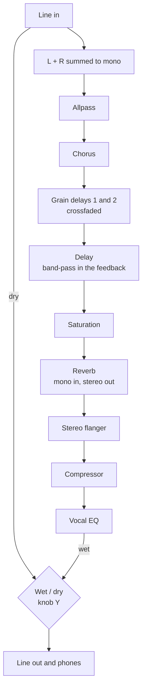

# Overview

VoiceFX is an effects processor for the voice, using the [NISPS](/memlnaut/approaches/nisps) approach to ML. It grew out of [LiveFX](/memlnaut/firmwares/livefxnisps): it keeps the grain delays, delay, chorus, allpass and reverb, adds a stereo flanger, a compressor and a vocal EQ, and gives you a single wet/dry knob. The neural network controls 59 parameters.

## Signal path

*Knob Y crossfades between your untouched input and the fully processed signal. Turned fully dry, it bypasses every effect.*

## The effects

Each block can be switched on or off on the [FX Enable](#fx-enable) screen. Most have their own mix that stays silent until the network's output passes about 30%, so an effect only comes in when the network turns it up.

The grain delays and the delay are **tempo synced**: their times snap to divisions of the beat. Set the tempo with the button on the [Neural Net](#neural-net) screen.

| Block | What it does |
|---|---|
| **Allpass** | A resonant, phasey smear: an allpass delay of 100–2000 samples, swept by an LFO (0.1–10 Hz) |
| **Chorus** | Two detuned modulated delays that thicken and widen the voice |
| **Grain delay 1** | Long grains (30–250 ms) for clouds and washes. Pitch shift (±1 octave), pitch spread, feedback and freeze |
| **Grain delay 2** | Short grains (10–100 ms) for glitches and stutters, with the same controls. The two are crossfaded |
| **Delay** | Tempo-synced echoes (1/16 to 1/2 beat) with up to 0.95 feedback. A band-pass filter in the feedback colours each repeat |
| **Saturation** | A fixed soft saturation on the effects bus before the reverb |
| **Reverb** | Size, decay, damping, diffusion, modulation, pre-delay, low cut, stereo width and saturation. Turns the bus into stereo |
| **Flanger** | A stereo jet flanger after the reverb, so the other effects don't smear its notches. The sweep moves evenly in pitch, from 0.2 ms up to 1–10 ms, at 0.05–2 Hz, with the right channel 90° behind the left. Feedback from −0.9 (hollow) to +0.9 (resonant) |
| **Compressor** | Stereo-linked, on the wet signal: threshold −40 to 0 dB, ratio 1:1 to 10:1, attack 0.5–50 ms, release 20–500 ms, makeup up to +12 dB |
| **Vocal EQ** | One peaking band that moves through the vocal range, 100 Hz–8 kHz, with ±10 dB of boost or cut and a Q of 0.5–4. It glides smoothly and has its own wet/dry |

## Inputs and outputs

The processor takes a stereo line input. The effects bus is mono until the reverb, then stereo. The dry signal stays stereo. Set the input level on the [Input Gain](#input-gain) screen.

# Quick start

1. Flash the firmware, connect a microphone preamp or other line-level source, and turn up **G**.
2. Set the level on the **Input Gain** screen while watching the input meters on the **VU** screen.
3. Set the wet/dry balance with **knob Y**.
4. Tap the tempo on the **Neural Net** screen, if you want the delays in time.
5. Move the joystick, then like, dislike, drag and jolt as described on the [NISPS page](/memlnaut/approaches/nisps#quick-start).

# Controls

*Click the panel to enlarge it. Controls ringed in gold work differently from the standard NISPS controls.*

The controls are the standard [NISPS controls](/memlnaut/approaches/nisps#controls), with this change:

| Control | In VoiceFX |
|---|---|
| **Knob Y** | Wet/dry mix (instead of reward scale). Fully dry bypasses every effect |

The joystick only explores; unlike LiveFX's DJ Mode, it doesn't change the wet/dry mix. The network's input defaults to the joystick. You can change it on the **Input Source** screen, including to machine listening of the line input.

# Screens

## Neural Net

The network's 59 outputs, its training error and memory, and a **tap tempo** button. Tap it in time with the music to set the tempo for the grain delays and the delay.

## Focus

Choose which effects the network changes: **Gr1**, **Gr2**, **Dly**, **Flgr**, **Chr**, **AP**, **Rev**, **Comp** and **EQ**. Everything outside the focused groups holds still, so you can train one effect at a time.

## FX Enable

Turn each block on or off: **Allpass**, **Flanger**, **Chorus**, **Grain 1**, **Grain 2**, **Delay**, **Reverb**, **Comp** and **EQ**. Highlighted blocks are on. The settings are saved with each model.

## VU

Input and output levels for both channels.

## Input Gain

The codec's analog input gain, from 0 to +22.5 dB in 1.5 dB steps. It boosts the signal before it's digitised, so quiet sources keep their quality. The gain changes as you drag the fader, and is saved when you let go, so it comes back the next time you switch on.

The other screens are the standard ones: **NN Inputs**, **Save Model**, **Load Model** and **Input Source**.

# Parameters

| Outputs | What they control |
|---|---|
| 0–7 | Grain delay 1: grain length, start time (in beat divisions), feedback, pitch, pitch spread, freeze |
| 8–15 | Grain delay 2 |
| 16–17 | Crossfade and mix between the grain delays |
| 18–20 | Delay: time, feedback, level |
| 21–25 | Flanger: maximum delay, sweep depth, rate, feedback, mix |
| 26–30 | Chorus |
| 31–35 | Allpass and its LFO |
| 36–38 | Band-pass filter in the delay feedback: frequency, Q, mix |
| 39–49 | Reverb |
| 50–54 | Compressor: threshold, ratio, attack, release, makeup |
| 55–58 | Vocal EQ: frequency, gain, Q, mix |

# MIDI

This firmware doesn't send the neural network outputs as MIDI. It does listen for MIDI CCs, so you can control NISPS from a footcontroller or similar:

| CC | Action |
|---|---|
| 1 | Positive reward |
| 2 | Negative reward |
| 3 | Scramble neural network |
| 4 | Clear replay memory |
| 5 | Exploration noise |
| 6 | Training speed |

If you choose a MIDI controller on the **Input Source** screen, CCs 1-8 become inputs to the neural network instead.

# Files

## Code

[https://github.com/MusicallyEmbodiedML/MEMLNaut-NISPS](https://github.com/MusicallyEmbodiedML/MEMLNaut-NISPS). To build this firmware, define `MODE_VOICEFX` in `MEMLNaut-NISPS.ino`.

## Firmware Download

[MEMLNaut-NISPS.VoiceFX.1.2.1.uf2](https://github.com/MusicallyEmbodiedML/MEMLNaut-NISPS/releases/download/1.2.1/MEMLNaut-NISPS.VoiceFX.1.2.1.uf2)

See the firmware [guide](./guide) for installation instructions.
